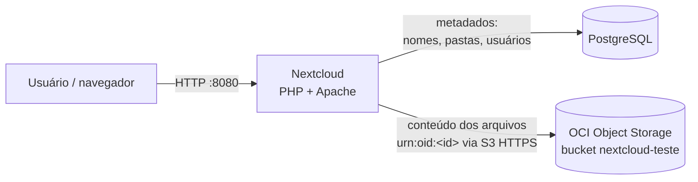
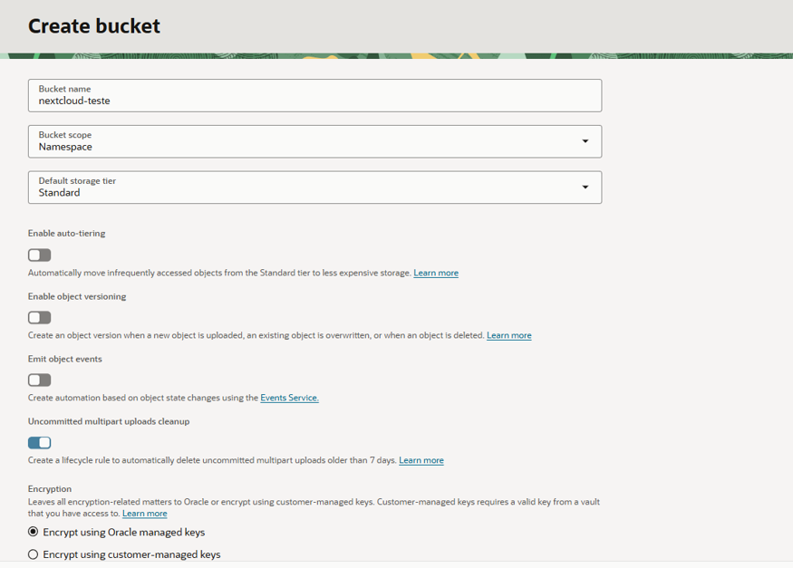
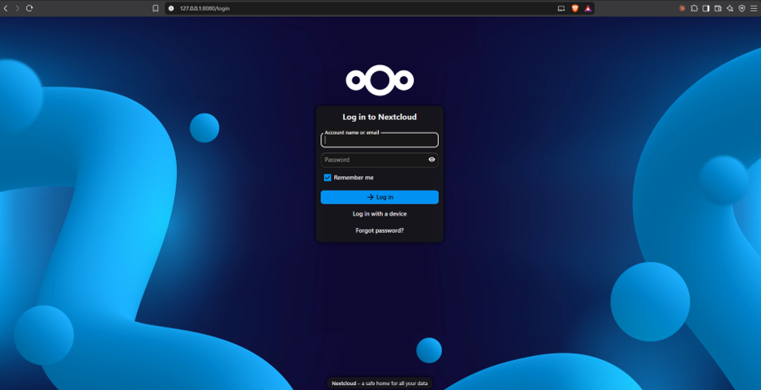
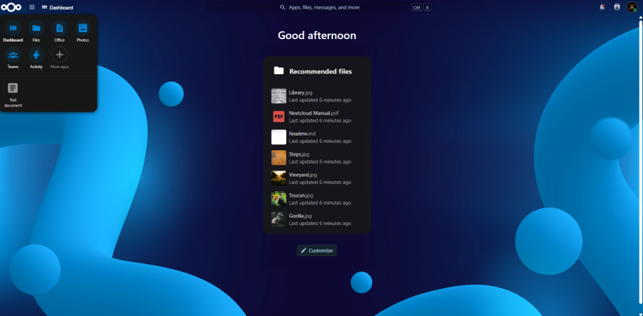
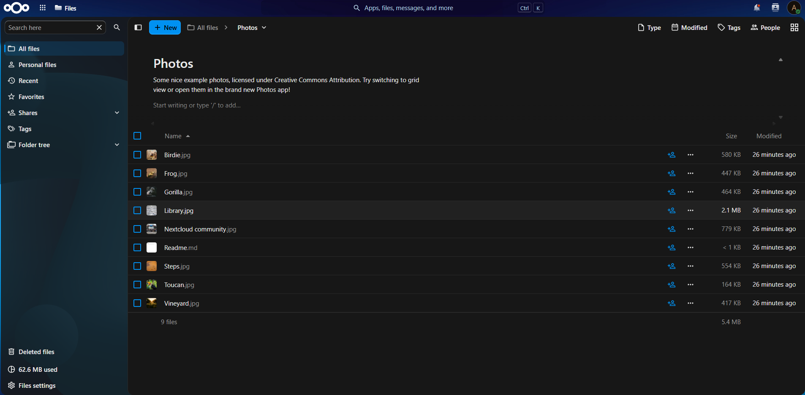
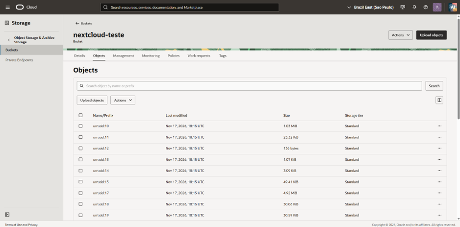

# Nextcloud com OCI Object Storage — Guia de configuração

> Ambiente local com Docker, usando um bucket da OCI como *primary storage* via API compatível com S3.

| Campo | Valor |
|---|---|
| Autora | Maria Eduarda Alves Duarte |
| Equipe | Statum — Backend & DevOps |
| Data | 17/11/2026 |
| Versão | 1.0 |
| Status | Validado em ambiente local (Fase 1) |

Este guia descreve, passo a passo, como subir o Nextcloud em Docker usando um bucket do **OCI Object Storage** como armazenamento principal (*primary storage*), através da API compatível com S3. O objetivo é reproduzir localmente uma arquitetura de produção baseada em OCI e servir de base para o futuro deploy em uma VM da OCI.

## Sumário

1. [Objetivo e escopo](#1-objetivo-e-escopo)
2. [Ambiente testado](#2-ambiente-testado)
3. [Arquitetura](#3-arquitetura)
4. [Pré-requisitos](#4-pré-requisitos)
5. [Configuração na OCI](#5-configuração-na-oci)
6. [Validação das credenciais (AWS CLI)](#6-validação-das-credenciais-aws-cli)
7. [Configuração do projeto](#7-configuração-do-projeto)
8. [Subindo o ambiente](#8-subindo-o-ambiente)
9. [Acesso e validação](#9-acesso-e-validação)
10. [Segurança e boas práticas](#10-segurança-e-boas-práticas)
11. [Próximos passos](#11-próximos-passos)
12. [Referências](#12-referências)

---

## 1. Objetivo e escopo

O Nextcloud é uma plataforma open source de arquivos e colaboração hospedada pela própria organização. No nosso cenário, o conteúdo dos arquivos é armazenado no **OCI Object Storage**.

**Dentro do escopo deste guia:**

- Criação e configuração do bucket e das credenciais S3 na OCI;
- Validação das credenciais de forma isolada;
- Subida do Nextcloud + PostgreSQL com Docker Compose, apontando para o bucket;
- Acesso e validação do ambiente.

**Fora do escopo (próximas fases):** deploy na VM da OCI, HTTPS/proxy reverso, Redis, cron, backup e editor de documentos online.

## 2. Ambiente testado

| Item | Versão / valor |
|---|---|
| Sistema operacional | Windows 11 com Docker Desktop (PowerShell 5.1) |
| Nextcloud | 35.0.3.2 — imagem `nextcloud:35-apache` |
| Banco de dados | PostgreSQL 18 — imagem `postgres:18-alpine` |
| PHP / Apache | PHP 8.5.12 / Apache 2.4.69 (dentro da imagem) |
| Região OCI | Brazil East (São Paulo) — `sa-saopaulo-1` (home region) |
| Bucket | `nextcloud-teste` — compartment raiz, tier Standard |
| Conta OCI | Conta pessoal no modo Always Free (laboratório) |

## 3. Arquitetura

O Nextcloud separa **metadados** de **conteúdo**. Com o object storage configurado como *primary storage*, cada componente guarda uma parte diferente da informação:



| Componente | Responsabilidade | Onde fica |
|---|---|---|
| Nextcloud (app) | Aplicação PHP + Apache, interface web e API (WebDAV) | Container `app`; código e `config.php` no volume `nextcloud` |
| PostgreSQL | Metadados: nomes de arquivos, pastas, usuários, compartilhamentos | Container `db`; volume `db` |
| OCI Object Storage | Conteúdo binário dos arquivos | Bucket `nextcloud-teste` (objetos `urn:oid:<id>`) |

**Fluxo de um upload:** o usuário envia o arquivo ao Nextcloud → o Nextcloud registra o arquivo no PostgreSQL e recebe um ID → o conteúdo é gravado no bucket como `urn:oid:<id>` pela API S3 da OCI (HTTPS, porta 443).

> [!IMPORTANT]
> **Consequências desse modelo:**
> - **O bucket não é navegável por fora:** os objetos não têm o nome original; o mapeamento está apenas no banco.
> - **Backup = banco + bucket juntos.** Um sem o outro não permite recuperar os arquivos.
> - **O primary storage é definido na instalação.** Trocar depois deixa os arquivos existentes inacessíveis — é preciso reinstalar (ou migrar).
> - **O Nextcloud precisa de acesso exclusivo ao bucket.** Não compartilhe o bucket com outras aplicações.

## 4. Pré-requisitos

- Docker Desktop instalado e em execução;
- Acesso ao console da OCI com permissão para criar buckets e Customer Secret Keys;
- Git (para versionar o projeto);
- Porta 8080 livre na máquina local (ou outra, ajustável no `.env`).

## 5. Configuração na OCI

### 5.1 Confirmar a região e a home region

No console: nome da região (topo da tela) → **Manage regions**. Anote o **Region identifier** da região marcada como **Home Region** — no nosso caso, `sa-saopaulo-1`.

A API S3 da OCI cria e procura buckets, por padrão, na home region e no compartment designado. Se o bucket estiver em outra região, a região precisa ser informada explicitamente.

### 5.2 Criar o bucket

Menu ☰ → **Storage** → **Buckets** → selecione o compartment raiz (`<tenancy> (root)`) → **Create bucket**.

| Campo | Valor | Motivo |
|---|---|---|
| Bucket name | `nextcloud-teste` | Apenas minúsculas e hífen (regras de nome da AWS) |
| Bucket scope | Namespace | Compatível com URLs *path-style*, usadas pelo Nextcloud |
| Default storage tier | Standard | Acesso frequente; Archive é lento para leitura |
| Auto-tiering | Desligado | Desnecessário para o teste |
| Object versioning | Desligado | O Nextcloud tem versionamento próprio; evita consumo extra |
| Emit object events | Desligado | Sem automações por evento |
| Uncommitted multipart uploads cleanup | **Ligado** | Remove partes de uploads que falharam (após 7 dias) |
| Encryption | Oracle managed keys | Padrão da OCI |
| Visibilidade | Private | O bucket nunca deve ser público |



> [!NOTE]
> **Por que o compartment raiz:** buckets criados ou acessados pela API S3 ficam no compartment designado para essa API, que por padrão é o raiz. Se o bucket estiver em outro compartment, o Nextcloud retorna `NoSuchBucket`. Em ambientes corporativos, recomenda-se criar um compartment dedicado e designá-lo em **Tenancy details → Edit Object Storage Settings**.

### 5.3 Obter o namespace

Abra o bucket criado: o campo **Namespace** aparece na aba **Details**. Também pode ser visto em **Tenancy details → Object storage namespace**.

> [!TIP]
> Copie e cole o valor — não digite. Caracteres como `9`/`g` e `1`/`l` se confundem facilmente.

### 5.4 Gerar a Customer Secret Key (credencial S3)

1. Ícone de perfil → **User settings** → **Customer secret keys** (pode estar na aba **Tokens and keys**);
2. **Generate secret key**, com um nome descritivo (ex.: `nextcloud-teste`);
3. Copie a **Secret key** imediatamente — ela é exibida uma única vez;
4. Feche a janela e copie a **Access key** exibida na lista (não use o OCID nem o nome da chave).

| Credencial | Formato | Variável no `.env` |
|---|---|---|
| Access key | 40 caracteres hexadecimais (`0-9`, `a-f`) | `OBJECTSTORE_S3_KEY` |
| Secret key | 44 caracteres em base64 (pode conter `/`, `+` e `=`) | `OBJECTSTORE_S3_SECRET` |

> [!CAUTION]
> Ao copiar os valores do console, confira se não veio uma quebra de linha ou espaço junto.
>
> Cada usuário pode ter no máximo **duas** Customer Secret Keys ao mesmo tempo. Uma chave recém-criada pode levar alguns minutos para ficar ativa.

### 5.5 Montar o endpoint S3

O endpoint é composto pelo namespace e pela região, **sem o nome do bucket**:

```text
<namespace>.compat.objectstorage.<region>.oraclecloud.com
```

## 6. Validação das credenciais (AWS CLI)

Antes de configurar o Nextcloud, valide as credenciais de forma isolada. O AWS CLI é apenas um cliente S3 genérico: o parâmetro `--endpoint-url` faz com que ele se comunique com a OCI. **Não é necessária conta na AWS**, e ele roda via Docker.

**PowerShell — comando em uma única linha:**

```powershell
docker run --rm -e AWS_ACCESS_KEY_ID="<ACCESS_KEY>" -e AWS_SECRET_ACCESS_KEY="<SECRET_KEY>" amazon/aws-cli s3 ls s3://nextcloud-teste --endpoint-url https://<namespace>.compat.objectstorage.sa-saopaulo-1.oraclecloud.com --region sa-saopaulo-1
```

**PowerShell — versão em várias linhas** (o acento grave no fim de cada linha continua o comando; **não funciona no CMD**):

```powershell
docker run --rm `
  -e AWS_ACCESS_KEY_ID="<ACCESS_KEY>" `
  -e AWS_SECRET_ACCESS_KEY="<SECRET_KEY>" `
  amazon/aws-cli s3 ls s3://nextcloud-teste `
  --endpoint-url https://<namespace>.compat.objectstorage.sa-saopaulo-1.oraclecloud.com `
  --region sa-saopaulo-1
```

| Resultado | Interpretação |
|---|---|
| Nenhuma saída e nenhum erro | Credenciais OK (bucket vazio). Pode seguir para o Nextcloud. |
| Lista de objetos | Credenciais OK (bucket já possui dados). |
| `SignatureDoesNotMatch` / `InvalidAccessKeyId` | Problema na chave, no namespace ou na região — não é o Nextcloud. |

## 7. Configuração do projeto

### 7.1 Estrutura do repositório

```text
nextcloud-oci-lab/
├── .gitignore
├── .env.example          # modelo com todas as variáveis (valores fictícios)
├── README.md             # este guia
├── assets/               # imagens do guia
└── oci-bucket/
    ├── .env              # valores reais — NÃO versionar
    └── docker-compose.yml
```

### 7.2 `.gitignore`

Criar **antes do primeiro commit**. Um segredo que entra no histórico do Git continua lá mesmo depois de apagado.

```gitignore
# Vale em qualquer pasta (oci-bucket/.env, local-rustfs/.env, ...)
.env
.env.*

# O modelo com valores fictícios deve ser versionado
!.env.example
```

### 7.3 Variáveis de ambiente (`.env`)

Versione apenas o `.env.example`, com valores fictícios. O `.env` real fica somente na máquina de quem executa, **na mesma pasta do `docker-compose.yml`**:

```powershell
Copy-Item .env.example oci-bucket\.env
```

```dotenv
# Nextcloud — instalação automática
NEXTCLOUD_ADMIN_USER=admin
NEXTCLOUD_ADMIN_PASSWORD=<senha-forte>
NEXTCLOUD_TRUSTED_DOMAINS="localhost 127.0.0.1"
NEXTCLOUD_HTTP_PORT=8080

# PostgreSQL
POSTGRES_DB=nextcloud
POSTGRES_USER=nextcloud
POSTGRES_PASSWORD=<senha-forte>

# OCI Object Storage (API compatível com S3)
OBJECTSTORE_S3_HOST=<namespace>.compat.objectstorage.sa-saopaulo-1.oraclecloud.com
OBJECTSTORE_S3_PORT=443
OBJECTSTORE_S3_SSL=true
OBJECTSTORE_S3_REGION=sa-saopaulo-1
OBJECTSTORE_S3_BUCKET=nextcloud-teste
OBJECTSTORE_S3_USEPATH_STYLE=true
OBJECTSTORE_S3_AUTOCREATE=false
OBJECTSTORE_S3_KEY=<access-key>
OBJECTSTORE_S3_SECRET=<secret-key>
```

> [!WARNING]
> **Regras para o `.env`:**
> - Cada valor **inteiro em uma única linha**, sem espaços sobrando. Não use aspas nas chaves S3.
> - Evite `$` nas senhas: o Docker Compose interpreta `$` como variável.
> - As senhas do PostgreSQL e do admin só são aplicadas na **primeira** subida. Para trocá-las no laboratório, recrie os volumes (`docker compose down -v`).

### 7.4 `docker-compose.yml`

Os nomes das variáveis no `.env` são os mesmos que a imagem do Nextcloud espera, o que deixa o mapeamento direto. A sintaxe `${VAR:?mensagem}` faz o Compose **se recusar a subir** se uma variável obrigatória estiver faltando, em vez de fazer uma instalação incompleta (por exemplo, cair em SQLite sem avisar).

```yaml
name: nextcloud-oci

services:
  db:
    image: postgres:18-alpine
    restart: unless-stopped
    environment:
      POSTGRES_DB: ${POSTGRES_DB:?defina POSTGRES_DB no .env}
      POSTGRES_USER: ${POSTGRES_USER:?defina POSTGRES_USER no .env}
      POSTGRES_PASSWORD: ${POSTGRES_PASSWORD:?defina POSTGRES_PASSWORD no .env}
    volumes:
      - db:/var/lib/postgresql            # Postgres 18+: não é mais .../data
    healthcheck:
      test: ["CMD-SHELL", "pg_isready -U $${POSTGRES_USER} -d $${POSTGRES_DB}"]
      interval: 10s
      timeout: 5s
      retries: 5

  app:
    image: nextcloud:35-apache
    restart: unless-stopped
    depends_on:
      db:
        condition: service_healthy        # só inicia com o banco pronto
    ports:
      - "${NEXTCLOUD_HTTP_PORT:-8080}:80"
    volumes:
      - nextcloud:/var/www/html           # código, apps e config.php
    environment:
      # Instalação automática
      NEXTCLOUD_ADMIN_USER: ${NEXTCLOUD_ADMIN_USER:?defina NEXTCLOUD_ADMIN_USER no .env}
      NEXTCLOUD_ADMIN_PASSWORD: ${NEXTCLOUD_ADMIN_PASSWORD:?defina NEXTCLOUD_ADMIN_PASSWORD no .env}
      NEXTCLOUD_TRUSTED_DOMAINS: ${NEXTCLOUD_TRUSTED_DOMAINS:-localhost}
      # Banco (as 4 variáveis são obrigatórias)
      POSTGRES_HOST: db
      POSTGRES_DB: ${POSTGRES_DB}
      POSTGRES_USER: ${POSTGRES_USER}
      POSTGRES_PASSWORD: ${POSTGRES_PASSWORD}
      # Primary storage: bucket da OCI
      OBJECTSTORE_S3_HOST: ${OBJECTSTORE_S3_HOST:?defina OBJECTSTORE_S3_HOST no .env}
      OBJECTSTORE_S3_PORT: ${OBJECTSTORE_S3_PORT:-443}
      OBJECTSTORE_S3_SSL: ${OBJECTSTORE_S3_SSL:-true}
      OBJECTSTORE_S3_REGION: ${OBJECTSTORE_S3_REGION:?defina OBJECTSTORE_S3_REGION no .env}
      OBJECTSTORE_S3_BUCKET: ${OBJECTSTORE_S3_BUCKET:?defina OBJECTSTORE_S3_BUCKET no .env}
      OBJECTSTORE_S3_USEPATH_STYLE: ${OBJECTSTORE_S3_USEPATH_STYLE:-true}
      OBJECTSTORE_S3_AUTOCREATE: ${OBJECTSTORE_S3_AUTOCREATE:-false}
      OBJECTSTORE_S3_KEY: ${OBJECTSTORE_S3_KEY:?defina OBJECTSTORE_S3_KEY no .env}
      OBJECTSTORE_S3_SECRET: ${OBJECTSTORE_S3_SECRET:?defina OBJECTSTORE_S3_SECRET no .env}

volumes:
  db:
  nextcloud:
```

> [!NOTE]
> O `$$` no healthcheck escapa o `$`: a variável é resolvida pelo shell dentro do container, e não pelo Compose. O arquivo completo e comentado está em [`oci-bucket/docker-compose.yml`](oci-bucket/docker-compose.yml).

### 7.5 Parâmetros S3 explicados

| Variável | Valor | Por quê |
|---|---|---|
| `OBJECTSTORE_S3_HOST` | endpoint de compatibilidade | Provedor não-AWS: informar o host genérico, sem o bucket |
| `OBJECTSTORE_S3_PORT` / `_SSL` | `443` / `true` | Comunicação via HTTPS |
| `OBJECTSTORE_S3_USEPATH_STYLE` | `true` | Requisições no formato `host/bucket` em vez de `bucket.host` |
| `OBJECTSTORE_S3_REGION` | `sa-saopaulo-1` | Usada na assinatura das requisições (SigV4); se estiver errada, a assinatura não confere |
| `OBJECTSTORE_S3_AUTOCREATE` | `false` | O bucket é criado pelo console, com as configurações da seção 5.2 |
| `OBJECTSTORE_S3_KEY` / `_SECRET` | Customer Secret Key | Access key e secret key, nessa ordem (ver seção 5.4) |

## 8. Subindo o ambiente

Na pasta `oci-bucket`:

```powershell
# Opcional: validar o .env sem exibir nenhum valor
docker compose config --quiet; if ($?) { "OK" }

docker compose up -d
docker compose logs -f app
```

A primeira subida leva de 1 a 2 minutos, pois é quando a instalação acontece. Linhas esperadas no log:

```text
Initializing nextcloud 35.0.3.2 ...
New nextcloud instance
Installing with PostgreSQL database
Starting nextcloud installation
Nextcloud was successfully installed
Setting trusted domains…
Initializing finished
... AH00094: Command line: 'apache2 -D FOREGROUND'
```

A mensagem `Nextcloud was successfully installed` confirma também a integração com a OCI: a instalação só conclui se conseguir gravar no bucket. Use **Ctrl+C** para sair do log; os containers continuam rodando.

> [!NOTE]
> O aviso `AH00558: Could not reliably determine the server's fully qualified domain name` é inofensivo em ambiente de container.

## 9. Acesso e validação

### 9.1 Acessar a interface

Acesse `http://127.0.0.1:8080` (ou `http://localhost:8080`) e entre com o usuário e a senha de administrador definidos no `.env`.





### 9.2 Conferir os objetos no bucket

Para o usuário, os arquivos aparecem normalmente no Nextcloud, com nomes e pastas:



No console da OCI: **Buckets → nextcloud-teste → Objects**. Logo após a instalação já existem vários objetos `urn:oid:<id>` (arquivos de exemplo e dados internos). Ao fazer upload pelo Nextcloud, novos objetos aparecem — sem o nome original do arquivo, que fica no PostgreSQL.



### 9.3 Comandos úteis (`occ`)

```powershell
# Status da instalação
docker compose exec --user www-data app php occ status

# Configuração do sistema (valores sensíveis, como a secret, aparecem mascarados)
docker compose exec --user www-data app php occ config:list system
```

### 9.4 Checklist de validação

- [x] Log de instalação mostra `Nextcloud was successfully installed`
- [x] Tela de login acessível em `:8080`
- [x] Login como admin carrega o dashboard
- [x] Bucket contém objetos `urn:oid:*` após a instalação
- [ ] Upload de arquivo gera um novo objeto `urn:oid` no bucket

## 10. Segurança e boas práticas

- **Nunca** registrar access key ou secret em documentos, prints, chats ou commits. Usar sempre placeholders (`<ACCESS_KEY>`) na documentação;
- Se uma credencial for exposta, **revogá-la imediatamente** no console e gerar outra;
- Manter o bucket **privado** e de uso **exclusivo** do Nextcloud;
- Em ambiente corporativo, usar um **usuário de serviço dedicado** ao Nextcloud, com policy restrita ao bucket, em vez da credencial de um usuário pessoal;
- Usar um **compartment dedicado** ao projeto e designá-lo para a API S3;
- `docker compose config` (sem `--quiet`) exibe todos os valores do `.env`, inclusive a secret: não compartilhar sua saída;
- Fixar versões das imagens (ex.: `nextcloud:35-apache`), evitando `latest`. O Nextcloud só atualiza **uma versão principal por vez** (35 → 36 → 37);
- Planejar backup do **PostgreSQL e do bucket em conjunto**.

## 11. Próximos passos

| Fase | Atividade |
|---|---|
| Fase 1.1 | Adicionar Redis (cache/locking) e container de cron ao compose |
| Fase 1.2 | Repetir o laboratório com S3 local (RustFS) para desenvolvimento sem depender da OCI — apenas o `.env` muda |
| Fase 2 | Deploy na VM da OCI com o mesmo compose |
| Fase 2.1 | Proxy reverso com HTTPS, trusted domains e regras de rede (Security List/NSG + firewall do SO) |
| Fase 2.2 | Usuário de serviço, compartment dedicado e policies de menor privilégio |
| Fase 3 | Rotina de backup e teste de restauração (banco + bucket) |
| Fase 4 | Editor de documentos online (Collabora ou OnlyOffice) — requer HTTPS |
| Comparação | Validar a configuração final contra o `config.php` do ambiente de produção |

## 12. Referências

- [Nextcloud — Configuring Object Storage as Primary Storage](https://docs.nextcloud.com/server/stable/admin_manual/configuration_files/primary_storage.html)
- [Imagem oficial do Nextcloud (variáveis de ambiente)](https://github.com/nextcloud/docker)
- [Imagem oficial do PostgreSQL](https://hub.docker.com/_/postgres)
- [OCI — Amazon S3 Compatibility API](https://docs.oracle.com/iaas/Content/Object/Tasks/s3compatibleapi.htm)
- [OCI — Gerenciamento de credenciais (Customer Secret Keys)](https://docs.oracle.com/iaas/Content/Identity/Tasks/managingcredentials.htm)
